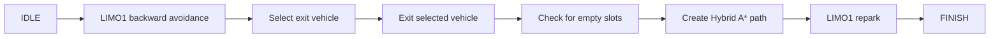

# Remote Parking Capstone

This team capstone project implements a multi-vehicle remote parking scenario in ROS 2 and Gazebo, from selecting a vehicle to exit through re-parking LIMO1 in the vacated space.

## Scenario



After the double-parked LIMO1 clears the aisle, the user selects A2, A3, or A4 to exit. Once the selected vehicle has left, the system verifies that the slot is empty, plans a path, and guides LIMO1 back into the vacated slot.

## System Components

| Package | Responsibility |
|---|---|
| `remote_parking_manager` | Mission FSM, Hybrid A* and Reeds-Shepp based path planning, vehicle control |
| `remote_parking_world` | Gazebo world, multi-vehicle spawning, initialization and vehicle selection script |
| `my_valet_parking` | Auxiliary nodes for dynamic tracking, exit control, slot detection, and parking |
| `limo_car` | LIMO URDF/Xacro files, meshes, and Gazebo configuration |

## Validation Focus

- The mission is divided into `IDLE → avoidance → vehicle selection → exit → slot verification → re-parking` states so each stage can be validated independently.
- `reset_robots.sh` resets vehicle positions without restarting Gazebo, supporting repeatable simulation tests.
- Vehicle exit uses path following, while re-parking combines Hybrid A* planning with Reeds-Shepp paths.
- Detailed design and analysis are documented in [SYSTEM_OVERVIEW.md](SYSTEM_OVERVIEW.md), [SYSTEM_ANALYSIS.md](SYSTEM_ANALYSIS.md), and [REMOTE_PARKING_IMPLEMENTATION_GUIDE.md](REMOTE_PARKING_IMPLEMENTATION_GUIDE.md).

## Original Environment

- Ubuntu 22.04
- ROS 2 Humble
- Gazebo Classic 11
- Python 3, NumPy, `pynput`

## Build and Run

```bash
source /opt/ros/humble/setup.bash
colcon build --symlink-install
source install/setup.bash
```

Execute each terminal in the following order:

```bash
# 1. Gazebo world
ros2 launch remote_parking_world world_server.launch.py gui:=true

# 2. Vehicles and control nodes
ros2 launch remote_parking_world spawn_robots.launch.py

# 3. Start the mission
ros2 service call /start_remote_parking std_srvs/srv/Trigger '{}'

# 4. Select the exit vehicle: a2, a3, or a4
bash src/remote_parking_world/scripts/select_car.sh a3
```

When retesting, the vehicle status is reset and the mission is restarted.

```bash
bash src/remote_parking_world/scripts/reset_robots.sh teleport
ros2 service call /start_remote_parking std_srvs/srv/Trigger '{}'
```

## License

Please check [THIRD_PARTY_NOTICES.md](THIRD_PARTY_NOTICES.md) for package-specific licenses and external component notices.

## Repository Relationship

- [Remote Parking Simulation Environment](https://github.com/gnoyk/WeMeet_Capstone_Base_Environment): LIMO ROS 2/Gazebo simulation environment and execution tools used to develop parking scenarios
- This repository: Capstone project integrating multi-vehicle remote parking scenario into FSM
