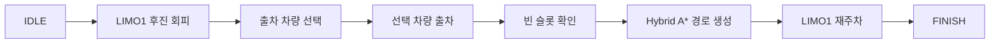

# Remote Parking Capstone

ROS 2와 Gazebo에서 다중 LIMO 차량의 출차 선택부터 빈 주차면 재주차까지 연결한 팀 캡스톤 결과물입니다.

> 이 저장소는 [SEA:ME Korea 팀 저장소](https://github.com/SEA-ME-KOREA/capstoneproject_2026F1)의 기존 Git 이력을 유지하면서, 공개용 문서와 생성 파일만 정리한 버전입니다.

## Scenario



이중주차 상태의 LIMO1이 통로를 비운 뒤 사용자가 A2, A3, A4 중 출차 차량을 선택합니다. 선택 차량의 출차가 끝나면 빈 슬롯을 확인하고, LIMO1이 계획된 경로를 추종해 재주차합니다.

## System Components

| Package | Responsibility |
|---|---|
| `remote_parking_manager` | 미션 FSM, Hybrid A* 및 Reeds-Shepp 기반 경로 계획, 차량 제어 |
| `remote_parking_world` | Gazebo 월드, 다중 차량 스폰, 초기화 및 차량 선택 스크립트 |
| `my_valet_parking` | 동적 추적, 출차 제어, 슬롯 탐지 및 주차 관련 보조 노드 |
| `limo_car` | LIMO URDF/Xacro, 메시 및 Gazebo 설정 |

## Validation Focus

- 미션을 `IDLE → 회피 → 차량 선택 → 출차 → 슬롯 확인 → 재주차` 상태로 분리해 단계별 동작을 확인했습니다.
- `reset_robots.sh`로 Gazebo를 재시작하지 않고 차량 위치를 초기화해 반복 시험할 수 있도록 구성했습니다.
- 출차는 경로 추종, 재주차는 Hybrid A*와 Reeds-Shepp 경로를 사용하는 구조로 통합했습니다.
- 상세 설계와 분석은 [SYSTEM_OVERVIEW.md](SYSTEM_OVERVIEW.md), [SYSTEM_ANALYSIS.md](SYSTEM_ANALYSIS.md), [REMOTE_PARKING_IMPLEMENTATION_GUIDE.md](REMOTE_PARKING_IMPLEMENTATION_GUIDE.md)에 남겨져 있습니다.

정량 성능 수치는 이 저장소의 기록만으로 재확인할 수 없어 별도로 기재하지 않았습니다. 현재 정리 환경은 Ubuntu 24.04이며, 아래의 원래 실행 환경에서 전체 시나리오를 새로 재시험한 것은 아닙니다.

## Original Environment

- Ubuntu 22.04
- ROS 2 Humble
- Gazebo Classic 11
- Python 3, NumPy, `pynput`

## Build and Run

```bash
source /opt/ros/humble/setup.bash
colcon build --symlink-install
source install/setup.bash
```

터미널별로 다음 순서로 실행합니다.

```bash
# 1. Gazebo 월드
ros2 launch remote_parking_world world_server.launch.py gui:=true

# 2. 차량과 제어 노드
ros2 launch remote_parking_world spawn_robots.launch.py

# 3. 미션 시작
ros2 service call /start_remote_parking std_srvs/srv/Trigger '{}'

# 4. 출차 차량 선택: a2, a3, a4
bash src/remote_parking_world/scripts/select_car.sh a3
```

재시험 시에는 차량 상태를 초기화한 뒤 미션을 다시 시작합니다.

```bash
bash src/remote_parking_world/scripts/reset_robots.sh teleport
ros2 service call /start_remote_parking std_srvs/srv/Trigger '{}'
```

## Repository Relationship

- [YSM Validation Workspace](https://github.com/gnoyk/YSM_ws): 개발 단계에서 사용한 ROS 2/Gazebo 시뮬레이션 검증 환경과 실행 도구
- 이 저장소: 원격 주차 시나리오를 하나의 FSM으로 통합한 팀 최종 결과물

## Attribution

원본 팀 저장소의 커밋 이력을 보존했습니다. 패키지별 라이선스 표기와 외부 구성요소의 출처는 [THIRD_PARTY_NOTICES.md](THIRD_PARTY_NOTICES.md)를 확인해 주세요. 저장소 전체에 단일 라이선스를 새로 부여하지 않았습니다.
